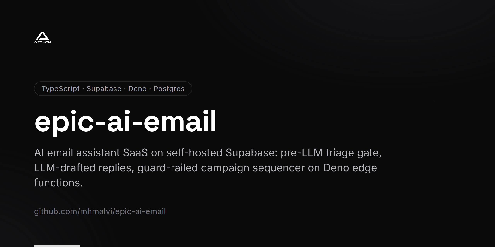
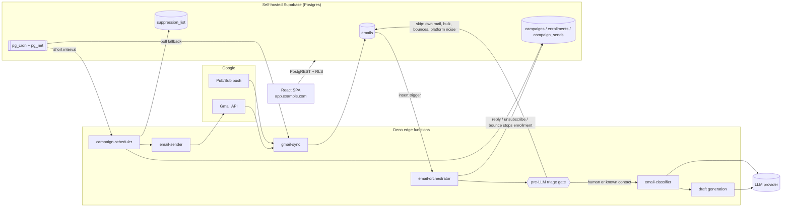

<!-- repo-card -->


# EPiC — AI email assistant SaaS

A Gmail-integrated email assistant: inbound triage and classification, LLM-drafted replies, a multi-mailbox inbox and a guard-railed cold-campaign sequencer, running on self-hosted Supabase with Deno edge functions.

Status: running in production on a self-hosted server since July 2026 (internal and pilot use).

## Problem

A small business inbox mixes three kinds of mail: a few real people writing in, a much larger volume of machine traffic, and copies of its own outbound mail. EPiC has to read all of it, spend model calls only where a human might be on the other end, draft replies, and run outbound sequences without damaging the sender's reputation. Every one of those jobs has a failure mode that costs money or deliverability: paying the model to read newsletters, cold mail leaving from the wrong mailbox, one campaign starving another of the daily cap, a bad list segment bouncing until the domain is filtered, and two overlapping cron runs emailing the same person twice.

## Architecture



- **Ingestion** — Gmail push notifications through Pub/Sub, with a pg_cron polling fallback; each synced message is stored once, with its direction derived from the `SENT` label and the owned-mailbox list rather than trusted from the caller.
- **Orchestrator** — fires on email insert. Runs the deterministic triage gate first, then user rules that only read the raw message, and only then calls the classifier and the draft generator.
- **Campaign scheduler** — an edge function invoked by pg_cron. Walks due sequence enrollments and sends the next step through `email-sender`, behind a stack of gates (send window, bounce breaker, warm-up, fair-share cap, sender pinning, mailbox backoff, even pacing, atomic claim).
- **Inbound side of campaigns** — the orchestrator stops an enrollment on reply, writes unsubscribe replies and bounces to `suppression_list`. Outbound mail carries a signed one-click `List-Unsubscribe` header.
- **Data layer** — self-hosted Supabase in Docker Compose: Postgres with row-level security, GoTrue auth, PostgREST, Realtime, Kong, Storage, pg_cron and pg_net. OAuth tokens are encrypted at rest with AES-GCM.
- **Frontend** — React + Vite SPA served as static files behind Caddy and a Cloudflare Tunnel, talking to the database only through PostgREST under RLS.

## Hard engineering decisions

### 1. Gate the model, not the label

**Decision.** Put a pure, rule-based triage function in front of every LLM call. It skips our own outbound mail, our own notifications, bounce notices, monitoring alerts, social-platform notifications, no-reply senders and anything carrying `List-Unsubscribe` or a Gmail bulk category. User rules that only read sender/subject/body were split out to run before the model too.

**Why.** A cost audit joined the LLM usage ledger to the emails table and found most of the spend went on mail no human needed to read. The rules engine already existed but ran after the model, so it could label an email but never prevent the spend that produced the label.

**Trade-off.** A skip rule can hide a real person. The gate is ordered so that a sender who is already a contact or enrollment outranks every machine-traffic rule (missing one outreach reply costs more than the calls the gate saves), the platform-domain list is kept deliberately narrow, and the gate is pure so every rule is unit-testable. The replay query lives next to the code and is meant to be re-run before any rule change.

### 2. Fair share of the daily cap, then pace evenly across the window

**Decision.** Each active campaign gets a slice of the per-user global daily cap proportional to its own limit (`fairShareCap`). Inside that slice, `pacedRunQuota` follows a straight line from zero at window open to the full allowance at window close, and on each tick sends only what brings today's total up to the line, bounded by a per-run cap and a trailing-hour mailbox ceiling.

**Why.** Campaigns run in their recipients' timezones. With one shared pool, first come first served, the Australian and UK windows (which open earlier in the UTC day) used the whole pool before the New York window opened, and US campaigns sent close to nothing. Separately, without pacing a campaign drained its allowance in the first tick of the morning, which looks like a burst to mailbox providers.

**Trade-off.** A share is a ceiling as well as a guarantee: capacity a quiet campaign leaves unused is not lent to a busy one that day. Because pacing is measured against what was actually sent, a tick that sent nothing catches up later, within the run cap.

### 3. A bounce circuit breaker that judges only a meaningful sample

**Decision.** Before sending, the scheduler compares recent bounces to recent sends over a rolling window. If the rate is over the threshold, it pauses the campaign and writes a high-severity `system_alerts` row. The rate is only judged once the window holds a minimum number of sends and a minimum number of bounces, and the window starts at the later of the rolling start and an operator-set `bounce_baseline_at` marker.

**Why.** A cumulative lifetime rate never recovers, so a cleaned list stayed paused. The first version also judged tiny samples, where two unlucky bounces paused a healthy campaign repeatedly. The baseline marker lets an operator say "the list was cleaned here" and have the campaign judged only on post-cleanup evidence.

**Trade-off.** A genuinely bad list sends more mail before the breaker can trip. That gap is narrowed by a first-send gate that resolves the recipient domain's MX record over DNS-over-HTTPS and suppresses dead domains instead of bouncing them; that lookup fails open so a DNS blip never blocks sending.

### 4. Pin the sender mailbox and fail closed

**Decision.** Campaign mail goes out only from the mailbox named in `CAMPAIGN_SENDER_EMAIL`. If that mailbox is disconnected, the campaign is skipped for the run rather than falling back to another connected account. A follow-up replies into the existing Gmail thread only if the sending mailbox owns that thread; otherwise it goes out as a fresh email under the plain step-one subject, and the enrollment stores the new thread id.

**Why.** The original code picked "the most recently updated connected account". Every connected account refreshes its OAuth token hourly, a fraction of a second apart, so the sender flipped between the business mailbox and a personal one at random. The flip also broke follow-ups: a Gmail thread id only exists in the mailbox that created it, so replying into it from another mailbox returns 404.

**Trade-off.** An expired token now stalls campaigns instead of sending from a fallback. That is the intended direction, and it is paired with token-health alerting so the stall is visible.

### 5. Claim each send with a lease, not a lock

**Decision.** Before sending, the scheduler runs a compare-and-set `UPDATE` that pushes the enrollment's `next_send_at` out by one lease, conditional on the row still being active and due. If the update matches zero rows, another run owns it and this run skips.

**Why.** The due set is a plain `SELECT` and the enrollment is only advanced after the send, so two overlapping cron invocations could select the same row and mail the same person twice. That was reproduced live. Postgres serialises the two updates, so exactly one wins.

**Trade-off.** Using `next_send_at` as both schedule and lease means a run killed mid-send delays that recipient by one lease instead of retrying at once. In exchange there is no separate lock table and no boolean flag that can be stranded by a crash. A Gmail rate-limit response hands the row back unchanged, with no send record, and the mailbox is not used again in that run.

### 6. Self-host Supabase rather than leave it

**Decision.** After the managed project was restricted for exceeding its egress quota, migrate to the self-hosted Supabase stack on our own server instead of moving to plain Postgres.

**Why.** The application is Supabase-native: edge functions, RLS policies, GoTrue auth, Storage, Realtime and an in-database scheduler. Self-hosting keeps the same API surface, so the move is a config change rather than a rewrite. The egress leak itself was an application bug (an analytics dashboard polling full email rows) and was fixed separately; self-hosting removes the metered ceiling, not the need for query discipline.

**Trade-off.** We now own backups, upgrades, disk and uptime on a single box. The cutover surfaced the things that break silently: cloud URLs baked into pg_cron jobs and into database function bodies (one of which looked like a URL but was a hash salt that must not change), pg_cron jobs restoring as active (they had to be disabled before verification so the scheduler would not send live mail), and a `Content-Security-Policy` meta tag that only a real browser login could catch. Row parity was checked through the public API path, the same path the app uses, and the cloud project was kept for rollback.

### 7. Close `SECURITY DEFINER` functions by default, and lock it with a test

**Decision.** Revoke `EXECUTE` on every `SECURITY DEFINER` function in `public` from `PUBLIC`, `anon` and `authenticated`; grant them to `service_role`; grant `authenticated` back only for the functions a logged-in page calls. Close the pg_net request queue to client roles. Encode all of it in a plain SQL test that runs in a rolled-back transaction.

**Why.** Postgres grants `EXECUTE` to `PUBLIC` by default, so every definer function was callable with the public anon key through PostgREST's `/rest/v1/rpc`, running with the owner's privileges. A migration fixes it once; a test keeps the next new function from reopening it.

**Trade-off.** Every new RPC the frontend needs must be granted explicitly, and the test's expected list must be updated with it. That friction is the point.

## Results

- **90.1% of LLM tokens removed** by the pre-LLM triage gate, measured by replaying 14,567 real model calls through it.
- **21,309 emails with exact row parity** at the self-host cutover, verified through the public API path; auth, RLS, Realtime, Storage and edge functions were exercised end to end after the move.
- **1,470 commits** in the repository.
- Qualitative: campaign mail is pinned to the business mailbox, campaigns in later timezones receive their share of the daily cap, and anonymous callers can no longer execute any `SECURITY DEFINER` function.

## Code excerpts

| File | What to look at |
|---|---|
| [`excerpts/triage.ts`](excerpts/triage.ts) | The pre-LLM gate: rule order, why a known contact outranks the skip rules, deriving direction from labels. |
| [`excerpts/campaign-pacing.ts`](excerpts/campaign-pacing.ts) | `fairShareCap` (proportional slice of the global cap) and `pacedRunQuota` (straight-line pacing that self-corrects). |
| [`excerpts/bounce-breaker.ts`](excerpts/bounce-breaker.ts) | The breaker predicate: minimum sample size and minimum bounce count before the rate counts. |
| [`excerpts/sender-account.ts`](excerpts/sender-account.ts) | Fail-closed sender pinning and the same-mailbox rule for threading follow-ups. |
| [`excerpts/campaign-scheduler.ts`](excerpts/campaign-scheduler.ts) | The gate sequence per campaign, warm-up ramp, seeded spintax and the lease-based compare-and-set claim. |
| [`excerpts/definer_execute_test.sql`](excerpts/definer_execute_test.sql) | Catalogue-level SQL assertions that lock `EXECUTE` grants on definer functions and the pg_net queue. |

The pure TypeScript excerpts have unit tests that run on Node's built-in test runner with no install (Node 22.18 or later, which strips TypeScript types natively):

```bash
node --test excerpts/tests/*.test.ts
```

## Tech stack

- TypeScript, React, Vite, Tailwind CSS with shadcn/ui, TanStack Query
- Supabase, self-hosted with Docker Compose: Postgres, row-level security, GoTrue, PostgREST, Realtime, Kong, Storage, pg_cron, pg_net
- Deno edge functions
- Gmail API with Pub/Sub push, Google Calendar and Drive APIs
- Gemini Flash behind a provider-switchable LLM wrapper
- Caddy and Cloudflare Tunnel in front of the static frontend and the API gateway
- Vitest, Playwright, Deno.test

## About

Built and operated by Muhammad H.M. Alvi — Founding AI Engineer, Aethon Automation Solutions. Contact: info@aethonautomation.com · https://github.com/mhmalvi

The full source is private. The files in `excerpts/` are sanitized excerpts of production code, trimmed as described in each file's header.
